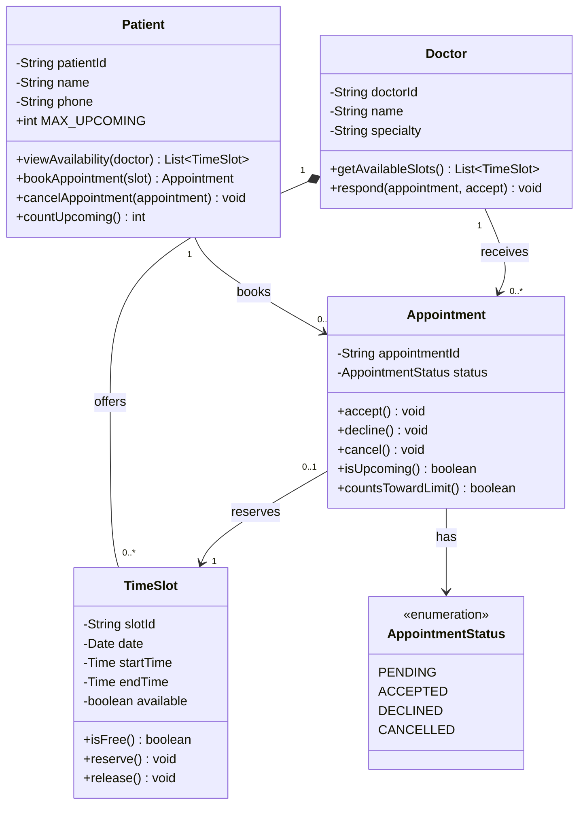

# Class Diagram

## Notes
- **Doctor to TimeSlot is composition**: a slot cannot exist without its doctor.
- **N = 3** is stored as `Patient.MAX_UPCOMING`. `countsTowardLimit()` is true only for future Pending/Accepted appointments (R4).
- `viewAvailability` / `getAvailableSlots` cover R1, `bookAppointment` covers R2, `respond` / `accept` / `decline` cover R3.
