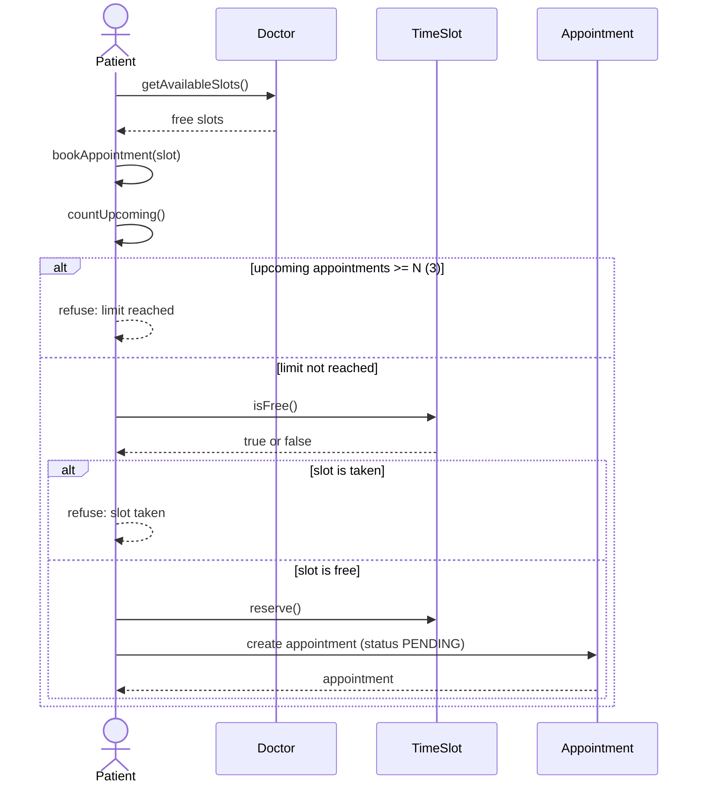
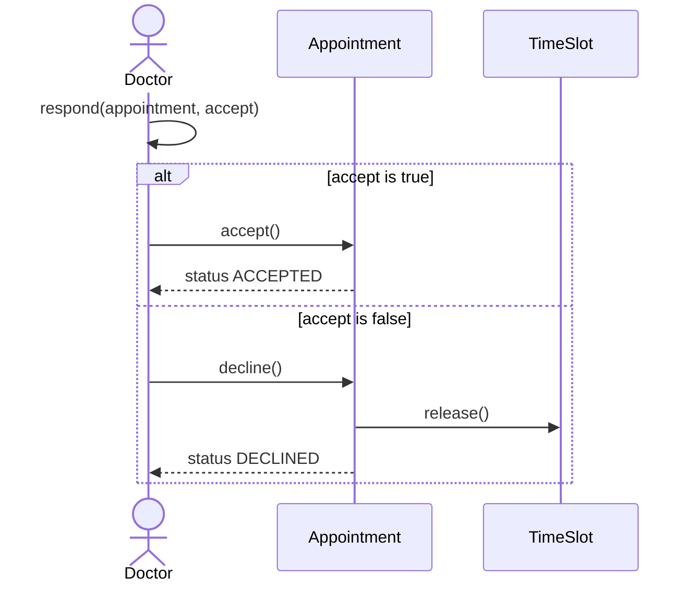

# Sequence Diagram

Every message below is a method from `class_diagram.md`.

## 1. Appointment request / booking (UC1, UC2, UC4 - R1, R2, R4)

## 2. Doctor accepts or declines the request (UC3 - R3)

## Checks
- The limit check (`countUpcoming`) happens BEFORE the slot is reserved.
- A declined request releases the slot, so it can be booked again and no longer counts toward N.
- Answers are dashed arrows; both the limit branch and the slot-taken branch exist (alt / else).
